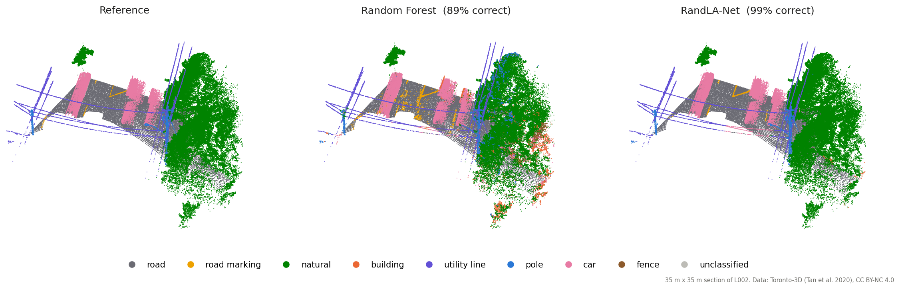
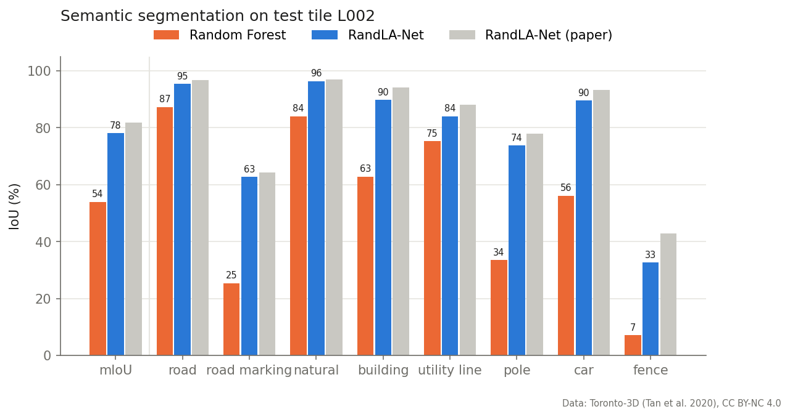
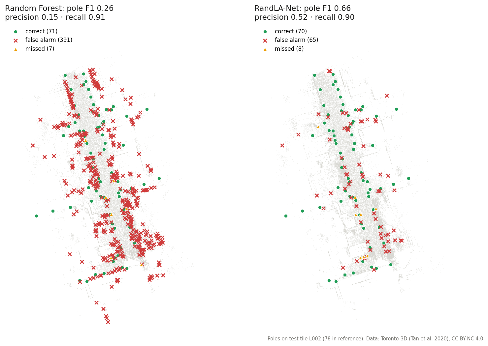

# Point cloud street assets

Automatic inventory of street poles and cars from mobile LiDAR, comparing a conventional
Random Forest with the deep-learning model **RandLA-Net** on the [Toronto-3D](https://github.com/WeikaiTan/Toronto-3D) dataset.

**RandLA-Net reaches 78.1 % mIoU (vs 54.0 %) and finds poles with F1 0.66 (vs 0.26), with 83 % fewer false alarms.**



## Results (test tile L002)



| Model | OA | mIoU | Pole F1 | Car F1 | Train time |
|---|---|---|---|---|---|
| Random Forest (handcrafted features) | 85.3 | 54.0 | 0.26 | 0.39 | 3 min (CPU) |
| **RandLA-Net** | **96.4** | **78.1** | **0.66** | **0.77** | 2 h (GTX 1650) |



Detected poles are located within 7 cm on average. The Random Forest labels each point independently, so its
scattered errors turn into hundreds of false poles; RandLA-Net's neighbourhood context removes most of them.

## How it works

1. **Prepare**: subsample the raw tiles to a 0.10 m voxel grid (chunked, fits in 8 GB RAM)
2. **Segment**: label every point with
   - a Random Forest on multi-scale geometric features (linearity, planarity, verticality, height, colour, intensity)
   - RandLA-Net, in pure PyTorch, trained on 32k-point crops
3. **Inventory**: group pole and car points into objects (position, height, size), match them to the reference within 1 m (poles) or 2 m (cars), and export CSV / GeoJSON

Runs are tracked with **MLflow**. A **Streamlit** app lets you explore the clouds in 3D, compare models side by side and inspect every detected object.

## Quick start

```bash
pip install torch --index-url https://download.pytorch.org/whl/cu126
pip install -e ".[dev]"

# Toronto_3D.zip: download in a browser from the link in the Toronto-3D repo, then
python scripts/download_toronto3d.py --zip path/to/Toronto_3D.zip

python -m streetinv.prepare
python -m streetinv.baseline
python -m streetinv.train
python -m streetinv.inventory --run randla
streamlit run app/streamlit_app.py
```

No data yet? Run the same pipeline on a synthetic street with `--config configs/synthetic.yaml`
(after `python scripts/make_synthetic.py`).

## Limitations

- 0.10 m grid (instead of the paper's 0.06 m) to fit 8 GB RAM, which explains most of the gap to the published 81.8 % mIoU
- Single test tile and a single training run. Toronto-3D has no instance labels, so the reference objects are derived from the point labels.
- Fences remain hard (33 % IoU), and poles are not yet split into types (lamp post, sign, traffic light)

## Data & licence

Toronto-3D (Tan et al., CVPRW 2020) is licensed CC BY-NC 4.0. The data is not included in this repo; the figures are derived from it.
RandLA-Net: Hu et al., CVPR 2020.
